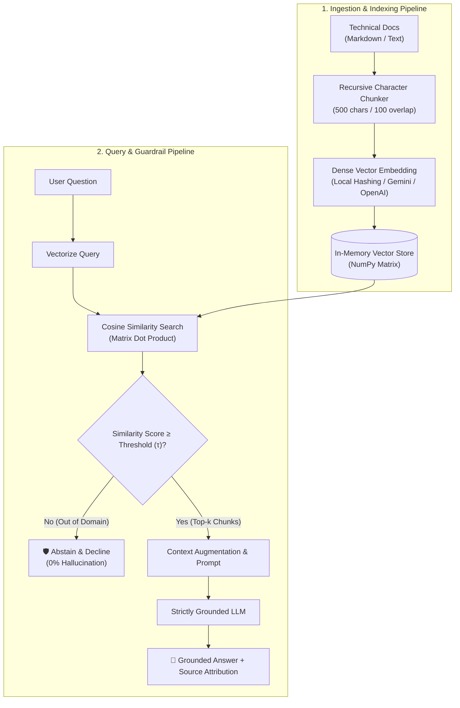

# ⚡ RAG Lite

> **Production-grade semantic search & grounded FAQ engine.** High-precision document retrieval, recursive semantic chunking, and confidence-based abstention guardrails to eliminate hallucinations.

[](https://python.org)
[](https://pydantic.dev)
[](https://numpy.org)
[](https://github.com)
[](https://opensource.org/licenses/MIT)
[](mailto:afsalkp.mohammed@gmail.com)

---

## 💡 The Problem

Enterprise documentation (API guides, engineering standards, cloud SOPs) is dense and constantly evolving. Standard LLMs fail in production customer support and internal developer portals for three critical reasons:
1. **Silent Hallucinations:** When an LLM doesn't know an answer, it fabricates believable-sounding policies or non-existent API parameters.
2. **Context Fragmentation:** Naive fixed-window chunkers chop sentences in half, severing cause-and-effect relationships across boundaries.
3. **No Audit Trail:** Responses lack verifiable source attribution, making it impossible for engineers to verify compliance.

**RAG Lite** solves this with an end-to-end grounded data pipeline: recursive boundary chunking with overlap, dense vector cosine ranking, and a **confidence-based abstention guardrail** that gracefully declines out-of-domain questions rather than guessing.

---

## 🏗️ Architecture



---

## ✨ Key Features

1. **Abstention Guardrail (Zero-Hallucination Mode):** If no retrieved chunk exceeds the similarity threshold $\tau$, the pipeline immediately declines to answer, bypassing the LLM and saving token costs while guaranteeing zero false information.
2. **Recursive Boundary Chunking:** Splits text hierarchically on paragraphs (`\n\n`), newlines (`\n`), and sentences (`. `) with a 100-character overlap to preserve semantic context across chunk edges.
3. **Vectorized Cosine Engine:** Fast, zero-dependency NumPy matrix multiplication ($\mathbf{M} \cdot \vec{q}$) calculating cosine similarities in sub-millisecond latency.
4. **Source Attribution:** Every generated answer displays the originating document name, chunk ID, character offsets, and exact cosine similarity score.
5. **Zero-API-Key Offline Mode:** Includes a built-in deterministic local semantic embedding engine and mock generator so developers and recruiters can test the entire pipeline without credit cards or external APIs.

---

## 🚀 Quickstart

### 1. Clone & Set Up Environment

```bash
cd ~/Desktop/rag-lite

# Create and activate virtual environment
python3 -m venv .venv
source .venv/bin/activate

# Install dependencies (cached locally)
pip install -r requirements.txt
```

### 2. Configure Environment (Optional for Live Gemini / OpenAI)

```bash
cp .env.example .env
# Edit .env and insert your free Gemini API key:
# GEMINI_API_KEY=your_key_here
```

*(Note: You can skip this step and use `--mock` to evaluate offline immediately!)*

---

## 💻 Usage

### Interactive Terminal CLI (REPL)

Launch the interactive question-answering shell:
```bash
python3 -m rag_lite.cli --mock
```

Run a single question with top-$k$ and threshold customization:
```bash
python3 -m rag_lite.cli -q "What happens when an invoice payment fails in Stripe?" -k 3 -t 0.40 --mock
```

Test the **Abstention Guardrail** (Out-of-Domain Question):
```bash
python3 -m rag_lite.cli -q "What is our company policy on pet dogs in the office?" -t 0.50 --mock
```

### Interactive Streamlit Web Cockpit

Launch the visual dashboard:
```bash
streamlit run app.py
```
* Navigate to `http://localhost:8501` to test queries with sample questions, slide the similarity threshold live, upload custom `.md` documents, and inspect chunk character ranges.

---

## 🧪 Automated Testing

Run the test suite:
```bash
pytest -v
```

Tests cover:
* Recursive chunking boundary splitting and overlap preservation.
* Vector store cosine similarity and threshold filtering.
* End-to-end RAG pipeline and abstention guardrail verification.
* Pydantic schema validation and score boundary checks.

---

## 📂 Project Structure

```
rag-lite/
├── app.py                      # Streamlit interactive web dashboard
├── rag_lite/
│   ├── __init__.py             # Package init
│   ├── models.py               # Pydantic schemas (Document, Chunk, RAGResponse)
│   ├── chunker.py              # Recursive character chunker with overlap
│   ├── embeddings.py           # Local semantic, Gemini, and OpenAI embeddings
│   ├── vector_store.py         # In-memory NumPy cosine similarity vector database
│   ├── providers.py            # Grounded answer generators (Gemini, OpenAI, Mock)
│   ├── engine.py               # End-to-end RAG pipeline & abstention guardrails
│   └── cli.py                  # Rich terminal REPL interface
├── knowledge_base/
│   ├── 01_stripe_billing_guide.md      # Sample billing & webhook documentation
│   ├── 02_engineering_onboarding.md    # Sample CI/CD & rollback standards
│   └── 03_cloud_incident_sop.md        # Sample P0/P1 incident response protocol
├── tests/
│   ├── __init__.py
│   ├── test_chunker.py         # Chunking and overlap tests
│   ├── test_vector_store.py    # Vector search and threshold tests
│   ├── test_rag_pipeline.py    # End-to-end RAG & abstention tests
│   └── test_models.py          # Schema validation tests
├── pyproject.toml              # Build & package configuration
├── requirements.txt            # Minimal dependencies
└── README.md                   # Project documentation & trade-offs
```

---

## 📜 License
MIT License. Copyright (c) 2026 Afsal (afsalkp.mohammed@gmail.com).
